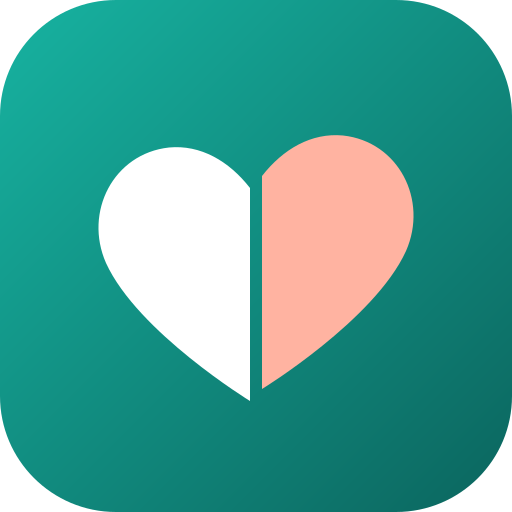
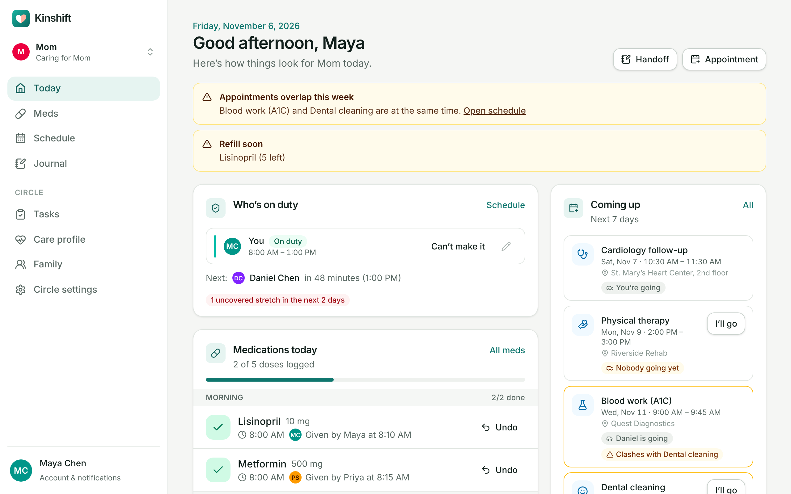
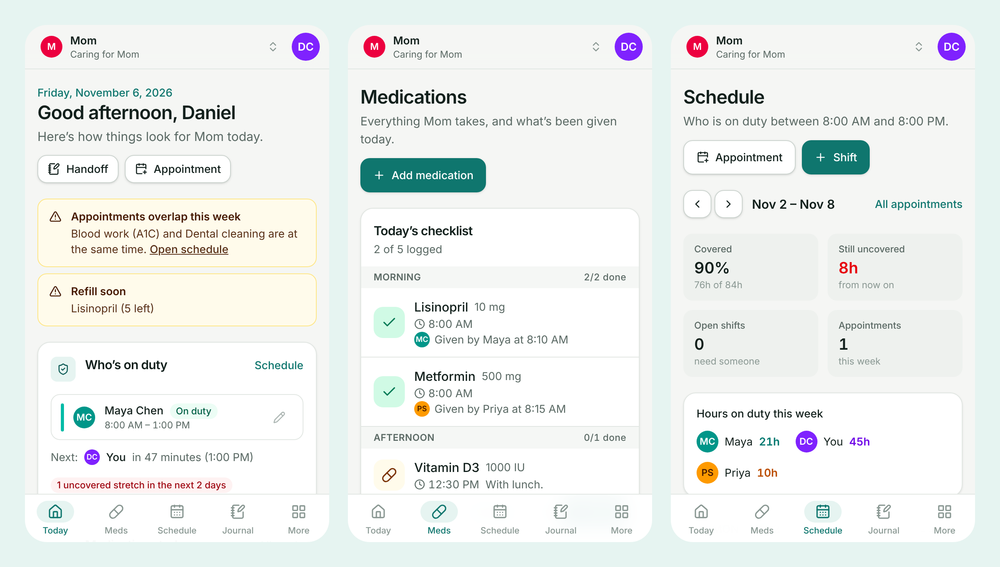
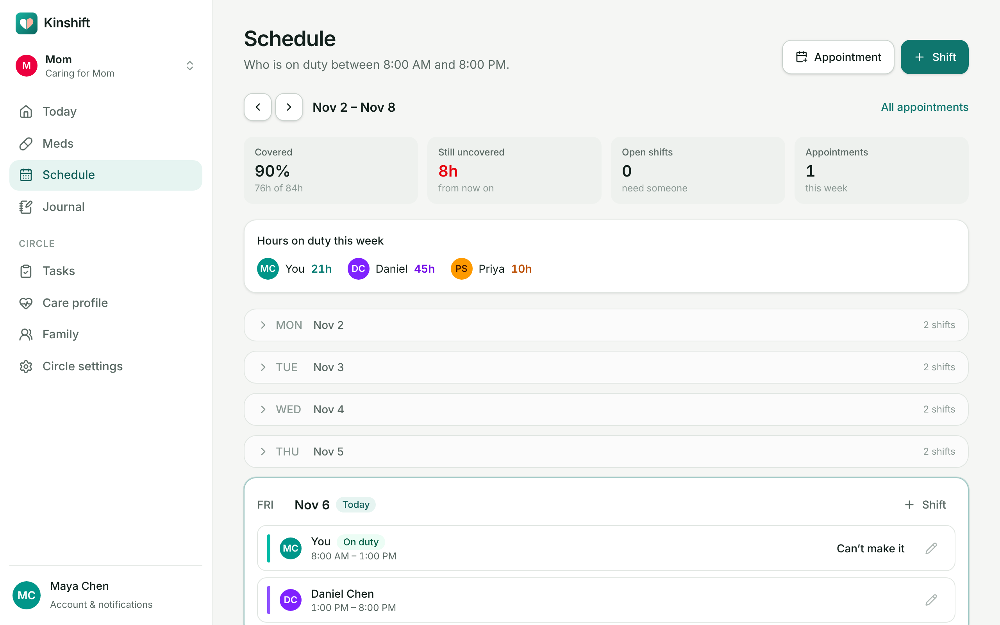
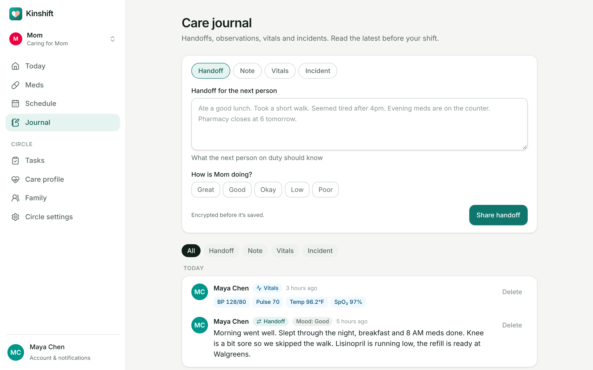
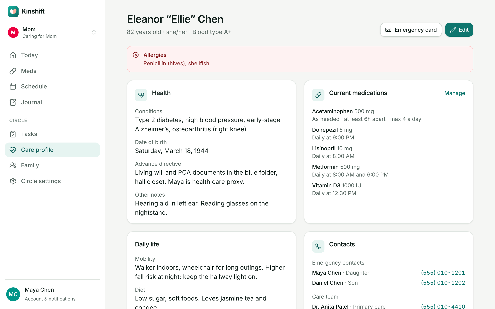
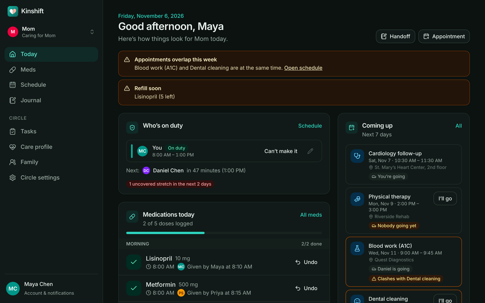

<div align="center">



# Kinshift

**The family caregiver hub. Share the care, drop the chaos.**

Shared medication tracking, care shifts, appointments and an encrypted care journal
for families looking after someone they love. Self-hosted, private by design, and
installable on any phone.

[](https://github.com/lobojoel2003/Kinshift/actions/workflows/ci.yml)
[](https://github.com/lobojoel2003/Kinshift/actions/workflows/codeql.yml)
[](https://github.com/lobojoel2003/Kinshift/releases/latest)
[](https://github.com/lobojoel2003/Kinshift/pkgs/container/kinshift)
[](LICENSE)

[Quick start](#quick-start) · [Features](#features) · [Self-hosting](#self-hosting) · [Security](#security-and-privacy) · [Development](#development) · [Releases](#versioning-and-releases)



</div>

## Why Kinshift

When siblings or a whole family share care for an aging parent or a disabled
relative, it usually runs on group chats and paper notes on the fridge. Meds get
missed or given twice, appointments clash, and nobody is sure who covers Tuesday.

This is a big and growing problem. According to
[AARP and the National Alliance for Caregiving (July 2025)](https://www.aarp.org/press/releases/2025-07-24-new-report-reveals-crisis-point-for-americas-63-million-family-caregivers.html):

- **63 million Americans**, nearly 1 in 4 adults, give ongoing care, up 20 million since 2015.
- Caregivers spend about **$7,200 a year** of their own money on care.
- Nearly **1 in 4 give 40 or more hours a week**.

Closed apps exist, but they keep your family's health data on someone else's
servers. Kinshift is a polished, open-source alternative that a non-technical
family can set up in minutes, that works well on a phone, and that keeps health
data private by design.

## Features



### 💊 No missed or doubled doses

- One shared checklist, grouped into morning, afternoon, evening and night.
- One tap marks a dose **given** or **skipped**, with who did it and when.
- The database itself refuses to record the same dose twice. If two siblings tap
  at the same moment, the second one is told “Already given by Daniel at 8:04 AM”.
- **As-needed** medications with minimum spacing and a daily maximum. Giving a
  dose outside the limits needs a reason and alerts the family.
- Supply tracking with refill warnings, 7- and 30-day adherence, and a full
  history for every medication.

### 🗓️ Know who covers Tuesday



- A weekly view of who is on duty, with past days folded away.
- **Uncovered hours are highlighted** inside the circle's coverage window
  (daytime, around the clock, or custom), with a one-tap “I’ll cover”.
- Open shifts anyone can claim, “can’t make it” that alerts everyone else,
  recurring weekly shifts, overnight shifts, and hours per person so the load
  stays fair.

### 🩺 Appointments without clashes

- Kinshift warns before saving an appointment that overlaps another one.
- Every appointment shows who is going along, and nudges the family when nobody is.
- Reminders the day before and two hours before.

### 📓 Handoffs, not group chats



- Handoff notes for whoever is on duty next, plus observations, **vitals**
  (blood pressure, pulse, temperature, SpO₂, glucose, weight) and **incidents**.
- Mood tracking and filters by entry type.
- Tasks for errands like refills and insurance calls.

### ❤️ Care profile and emergency card



Allergies, conditions, care team, emergency contacts, routines and advance
directive in one encrypted place, with a **printable emergency card** for the
hospital bag.

### 🔔 Reminders on every phone

Web push notifications for doses due, missed doses, upcoming and open shifts,
appointments, handoffs and incidents. Each person chooses what they get, and
**discreet wording** (on by default) keeps medication names off lock screens.

### 🌙 Thoughtful everywhere



- Installable app (PWA) for iPhone, Android and desktop, with automatic dark mode.
- Screens refresh on their own, so everyone sees the same thing.
- Organizer, caregiver and read-only viewer roles, with invite links that expire.
- Several care circles per person (for example, Mom and Grandpa).
- Export everything as JSON at any time. Your data is yours.

## Quick start

Try it on your computer with Docker:

```bash
docker run -d --name kinshift -p 3000:3000 -v kinshift-data:/data ghcr.io/lobojoel2003/kinshift:latest
```

Open http://localhost:3000, create the first account and follow the set-up
steps. Then invite your family from the **Family** page.

> [!TIP]
> Want to look around first? Load a demo family with
> `DATA_DIR=./demo-data npm run db:seed-demo` and sign in as `maya@example.com`
> with the password `kinshift-demo` (see [Development](#development)).

## Self-hosting

Kinshift is one container and one SQLite file. A Raspberry Pi, a NAS, a spare
laptop or a small VPS is plenty for a family.

### Docker Compose (recommended)

```bash
curl -O https://raw.githubusercontent.com/lobojoel2003/Kinshift/main/docker-compose.yml
curl -o .env https://raw.githubusercontent.com/lobojoel2003/Kinshift/main/.env.example
```

Set `KINSHIFT_SECRET` in `.env` (generate one with `openssl rand -hex 32`) and
`KINSHIFT_URL` to the address your family will use, then:

```bash
docker compose up -d
```

### One-click cloud deploy

[](https://render.com/deploy?repo=https://github.com/lobojoel2003/Kinshift)

The [Render blueprint](render.yaml) builds the image, attaches a persistent disk
for the database and generates `KINSHIFT_SECRET` for you. Any platform that runs
a Docker image with a persistent volume mounted at `/data` works the same way
(Fly.io, Railway, Coolify, CapRover, Unraid, Synology…).

### Without Docker

Download `kinshift-<version>-node.tar.gz` from the
[latest release](https://github.com/lobojoel2003/Kinshift/releases/latest),
then with Node.js 22 or newer:

```bash
tar -xzf kinshift-1.0.0-node.tar.gz
cd kinshift-1.0.0-node
KINSHIFT_SECRET="$(openssl rand -hex 32)" DATA_DIR=./data PORT=3000 node server.js
```

### HTTPS, phones and notifications

Browsers only allow installing the app and push notifications over **HTTPS**
(or on `localhost`). Put Kinshift behind a reverse proxy such as
[Caddy](https://caddyserver.com/) (automatic certificates), Traefik, nginx or a
Cloudflare Tunnel. With Caddy it is one line:

```caddyfile
care.example.com {
	reverse_proxy localhost:3000
}
```

Then, on each phone, open the site and choose **Add to Home Screen**, and turn
on notifications in **Account settings**. On iPhone, notifications work once the
app has been added to the Home Screen (iOS 16.4 or newer).

### Configuration

All settings are environment variables. Everything is optional.

| Variable                                | Default                        | What it does                                                                                                             |
| --------------------------------------- | ------------------------------ | ------------------------------------------------------------------------------------------------------------------------ |
| `KINSHIFT_SECRET`                       | generated in `DATA_DIR`        | Key material for encrypting health data at rest (32+ characters). **Back it up separately from the database.**           |
| `KINSHIFT_PREVIOUS_SECRET`              | –                              | The old secret while rotating. Kinshift re-wraps every circle key on start-up.                                           |
| `KINSHIFT_URL`                          | from the request               | Public URL used in invite links, e.g. `https://care.example.com`.                                                        |
| `KINSHIFT_REGISTRATION`                 | `invite`                       | `invite`: only the first person can sign up without an invite link. `open`: anyone who can reach the server can sign up. |
| `DATA_DIR`                              | `./data` (`/data` in Docker)   | Where the SQLite database and generated secret live.                                                                     |
| `DATABASE_PATH`                         | `$DATA_DIR/kinshift.db`        | Use a different database file.                                                                                           |
| `PORT` / `HOSTNAME`                     | `3000` / `0.0.0.0`             | Where the server listens.                                                                                                |
| `VAPID_PUBLIC_KEY`, `VAPID_PRIVATE_KEY` | generated and stored encrypted | Web push keys. Only set these to use your own.                                                                           |
| `VAPID_SUBJECT`                         | `KINSHIFT_URL` if HTTPS        | Contact for push services (`mailto:` or `https:`).                                                                       |
| `KINSHIFT_LOCALE`                       | `en-US`                        | Locale for dates and times.                                                                                              |
| `KINSHIFT_DISABLE_SCHEDULER`            | –                              | Set to `1` to turn off background reminders.                                                                             |
| `KINSHIFT_DISABLE_PUSH`                 | –                              | Set to `1` to never send push notifications.                                                                             |

### Backups and upgrades

- **Back up** the `/data` volume (it holds `kinshift.db`). For a consistent
  copy while running: `sqlite3 /data/kinshift.db ".backup /backups/kinshift.db"`.
- Keep `KINSHIFT_SECRET` (or `/data/kinshift.secret`) somewhere **else**. A
  database backup without the secret cannot be decrypted, which is the point.
- **Upgrade** by pulling the new image and restarting. Database migrations run
  automatically on start-up. Pin a major version (`ghcr.io/lobojoel2003/kinshift:1`)
  to receive fixes without breaking changes.
- **Health check:** `GET /api/health` returns the version, build number and
  commit.

## Security and privacy

Kinshift handles sensitive health information, so privacy is part of the design:

- **Encrypted at rest:** medication details, appointments, journal entries,
  vitals, tasks, the care profile, shift notes and the activity log are encrypted
  with AES-256-GCM. Every care circle has its own data key, wrapped by a key
  derived from `KINSHIFT_SECRET`. A stolen database file alone reveals nothing
  sensitive. This is verified by the end-to-end tests.
- **Accounts:** scrypt password hashing, hashed session and invite tokens,
  sign-out of other devices, rate-limited sign-in.
- **Web hardening:** nonce-based Content Security Policy, HSTS, `frame-ancestors 'none'`,
  CSRF-protected Server Actions and server-side permission checks everywhere.
- **No tracking:** no analytics, no third-party scripts, no external requests
  other than the push notifications you turn on. Pages with health data are
  never cached on the device.

Read the full [security policy](SECURITY.md) and how to report a vulnerability.

## How it's built

| Layer         | Choice                                                                                             |
| ------------- | -------------------------------------------------------------------------------------------------- |
| App           | [Next.js 16](https://nextjs.org/) App Router, React 19 Server Components and Server Actions        |
| UI            | Tailwind CSS 4, Lucide icons, Inter, a small accessible component kit                              |
| Data          | SQLite (WAL) via better-sqlite3 and [Drizzle ORM](https://orm.drizzle.team/), automatic migrations |
| Security      | Node.js crypto: AES-256-GCM, HKDF, scrypt                                                          |
| Notifications | Web Push (VAPID) with a service worker, and an in-process reminder scheduler                       |
| Time          | IANA time zones with `@date-fns/tz`, DST-safe scheduling                                           |
| Testing       | Vitest (unit and integration), Playwright (end to end)                                             |
| Delivery      | Multi-stage Docker image (amd64 and arm64), GitHub Actions, GHCR                                   |

```
src/
├── app/                 Pages, layouts and Server Actions
│   ├── (auth)/          Sign in and sign up
│   ├── (app)/c/[id]/    A care circle: today, meds, schedule, journal, tasks, profile, family
│   └── api/health/      Health check
├── components/          Shared UI (ui/ holds the design-system primitives)
├── lib/                 Domain logic: meds, coverage, crypto, auth, notifications, scheduler
└── proxy.ts             Per-request Content Security Policy
drizzle/                 SQL migrations
tests/                   Vitest unit and integration tests
e2e/                     Playwright end-to-end tests
```

## Development

Requires Node.js 22+.

```bash
git clone https://github.com/lobojoel2003/Kinshift.git
cd Kinshift
npm install
npm run dev
```

Load the demo family (four people, five medications, ten days of history,
shifts, appointments and journal entries):

```bash
DATA_DIR=./demo-data npm run db:seed-demo
DATA_DIR=./demo-data npm run dev
```

Useful scripts:

| Command                 | What it does                                             |
| ----------------------- | -------------------------------------------------------- |
| `npm run validate`      | Lint, type check, unit and integration tests, formatting |
| `npm run test:coverage` | Unit and integration tests with coverage                 |
| `npm run build`         | Production build (standalone server)                     |
| `npm run test:e2e`      | Playwright tests against the production build            |
| `npm run db:generate`   | Create a migration after changing `src/lib/db/schema.ts` |
| `npm run screenshots`   | Regenerate the images in `docs/images`                   |

See [CONTRIBUTING.md](CONTRIBUTING.md) for the full guide.

## Versioning and releases

Kinshift follows [Semantic Versioning](https://semver.org/). Every release has:

- a **git tag** (`v1.0.0`) and a [GitHub release](https://github.com/lobojoel2003/Kinshift/releases)
  with notes from the [changelog](CHANGELOG.md), a Node.js bundle and SHA-256 checksums;
- a **Docker image** on GHCR tagged `1.0.0`, `1.0`, `1` and `latest`, for
  `linux/amd64` and `linux/arm64`, with an SBOM and build provenance attestation;
- a **build number** (the GitHub Actions run number) and commit, shown in
  **Account settings → About** and at `/api/health`.

CI runs linting, type checks, unit and integration tests on Node 22 and 24,
end-to-end tests against the production build, a Docker smoke test and CodeQL
on every push and pull request. Pushing a `v*` tag publishes the release.

## Roadmap

- Email notifications as a fallback to push
- Calendar (iCal) feed of shifts and appointments
- Medication photos and pharmacy refill requests
- Translations
- Optional end-to-end encryption with family passphrases

Ideas and pull requests are welcome. Please open an issue first for larger changes.

## License

Kinshift is free software under the [GNU Affero General Public License v3.0](LICENSE).
If you run a modified version for other people, you must share your changes.
